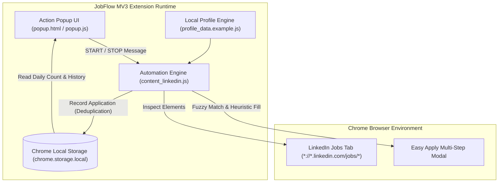

# JobFlow — Autonomous LinkedIn Application Assistant (Manifest V3 Prototype)

[](https://developer.chrome.com/docs/extensions/mv3/intro/)
[](https://developer.mozilla.org/en-US/docs/Web/JavaScript)
[](https://opensource.org/licenses/MIT)

> **Autonomous Browser Automation Prototype** engineered on Chrome Extensions Manifest V3.  
> Demonstrates pragmatic DOM traversal, heuristic form-field classification, rate limiting, and persistent deduplication algorithms.

---

> [!NOTE]
> **Prototype & Educational Demo Notice**  
> This project is a proof-of-concept prototype built to demonstrate browser automation patterns and fuzzy-matching logic for web application forms. It is provided for educational and portfolio demonstration purposes.

---

## 🏗️ Extension Architecture



---

## 🌟 Technical Highlights & Automation Logic

### 1. Heuristic Form-Field Classifier
* **Multi-Lingual Keyword Matching**: Parses label texts, placeholders, and element IDs in English and Spanish to categorize fields into:
  * Personal contact info (phone, email, postal code).
  * Numeric experience fields (maps keywords like *"continuous improvement"*, *"lean six sigma"*, or *"iso 9001"* to configured years).
  * Boolean screening questions (sponsorship, driver's license, willingness to relocate).
  * Dropdown options (education degree, language proficiencies, notice periods).

### 2. Smart Deduplication & Guardrails
* **Single Application per Company**: Prevents repetitive applications to the same employer by recording sanitized company names in `chrome.storage.local`.
* **Daily Rate Limiting**: Caps applications at 20 submissions per day with a visual progress bar and automatic midnight resets.
* **Humanized Jitter Delays**: Randomizes submission pauses (`randomDelay(1200, 2400)`) to emulate realistic human interaction intervals.

### 3. Zero-Server Privacy Model
* **100% Local Execution**: All candidate profile parameters and application histories remain strictly within your local browser storage. No data is ever transmitted to external telemetry servers.

---

## 🚀 Installation & Local Setup

### 1. Clone Repository
```bash
git clone https://github.com/desousaejai/jobflow-automation-extension.git
cd jobflow-automation-extension
```

### 2. Configure Your Profile (Optional)
The extension includes a safe default profile (`profile_data.example.js`). To customize it with your own parameters:
```bash
cp profile_data.example.js profile_data.js
```
*(Note: `profile_data.js` is automatically excluded by `.gitignore` to prevent committing personal credentials).*

### 3. Load into Google Chrome
1. Open Google Chrome and navigate to `chrome://extensions/`.
2. Toggle on **Developer mode** in the top right corner.
3. Click **Load unpacked** in the top left corner.
4. Select the `jobflow-automation-extension` folder.
5. The **JobFlow AI** badge will now appear in your Chrome toolbar!

---

## 👤 Author & Engineering Credits

* **Engineer**: **Eduardo De Sousa**
* **Role**: Operations & Automation Lead | Lean Six Sigma Black Belt | Full-Stack Systems Builder
* **Portfolio**: [https://eduardodesousa.vercel.app](https://eduardodesousa.vercel.app)
* **LinkedIn**: [linkedin.com/in/eduardo-desousa](https://www.linkedin.com/in/eduardo-desousa/)

---

## 📄 License
This project is licensed under the MIT License — see the [LICENSE](LICENSE) file for details.
